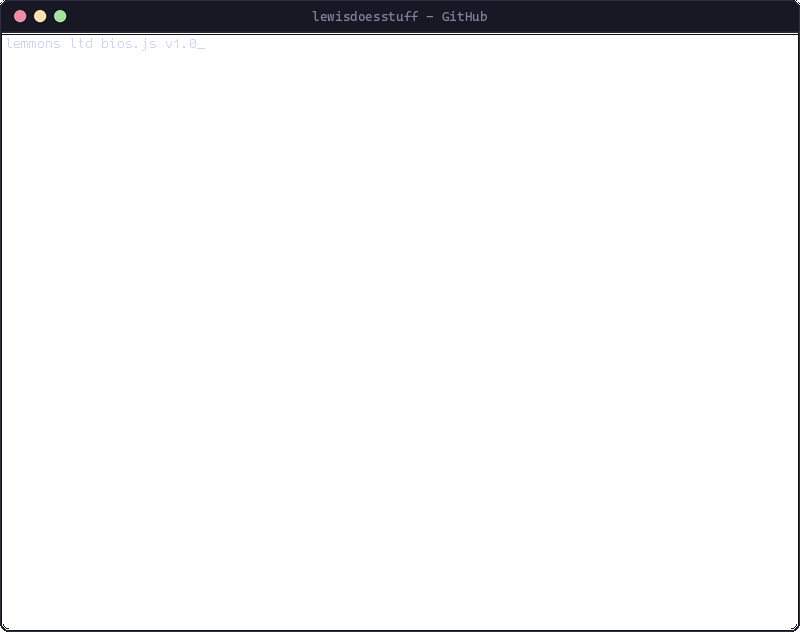

<picture>
    <source media="(prefers-color-scheme: dark)" srcset="output-dark.gif">
    <source media="(prefers-color-scheme: light)" srcset="output-light.gif">
    
</picture>
<!---
lewisdoesstuff/lewisdoesstuff is a ✨ special ✨ repository because its `README.md` (this file) appears on your GitHub profile.
You can click the Preview link to take a look at your changes.
--->
